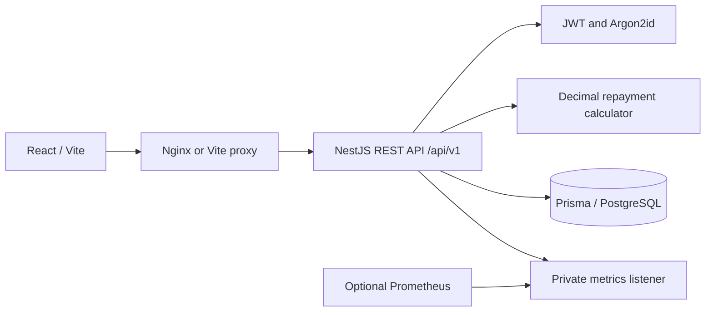

# Contract Repayment

Device Finance is a device repayment calculator and contract manager. Register
and sign in to compare 12, 24 and 36 month plans, save a repayment snapshot,
and view, update or delete your own contracts.



The API uses NestJS, TypeScript, Prisma, PostgreSQL, decimal.js and Swagger.
The web app uses React Router, TanStack Query, React Hook Form, Zod, Tailwind
and shadcn/ui components. Docker Compose provides local deployment.

## Quick start

Use Node.js **24.21.0**, npm **11.19.0**, Docker Desktop or Docker Engine with
Compose v2, and Git Bash or a comparable shell. Run from the source root.

```bash
npm ci
cp .env.example .env
node -e "const fs=require('node:fs');const p='.env';const s=fs.readFileSync(p,'utf8');if(/^JWT_SECRET=\r?$/m.test(s)===false)throw Error('Expected an empty JWT_SECRET');fs.writeFileSync(p,s.replace(/^JWT_SECRET=(\r?)$/m,(_,eol)=>'JWT_SECRET='+require('node:crypto').randomBytes(32).toString('base64url')+eol));"
docker compose -f compose.yaml -f compose.web.yaml -f compose.monitoring.yaml up --build -d --wait
```

Copy the example only for a new setup. PowerShell users can use
`Copy-Item .env.example .env` and `npm.cmd`. The JWT command generates
43 characters of unpadded base64url from 32 random bytes. Clear only the
existing JWT setting before rotating it. Rotation invalidates previously
issued tokens.

| Service                  | Local URL                                                                         |
| ------------------------ | --------------------------------------------------------------------------------- |
| Device Finance           | [localhost:8080](http://localhost:8080)                                           |
| API liveness             | [localhost:3000/api/v1/health](http://localhost:3000/api/v1/health)               |
| Database readiness       | [localhost:3000/api/v1/health/ready](http://localhost:3000/api/v1/health/ready)   |
| Swagger and OpenAPI JSON | [UI](http://localhost:3000/api/docs), [JSON](http://localhost:3000/api/docs-json) |
| Prometheus               | [Targets](http://localhost:9090/targets), [Alerts](http://localhost:9090/alerts)  |

Use `docker compose up --build -d --wait` for API and PostgreSQL only.
Include `-f compose.web.yaml` or `-f compose.monitoring.yaml` after
`-f compose.yaml` to add either service. Use the same file flags when stopping
a stack. `docker compose down` retains the data volume. Adding `--volumes`
deletes it.

### Configuration

| Setting          | Local configuration                                                                                                                                                                |
| ---------------- | ---------------------------------------------------------------------------------------------------------------------------------------------------------------------------------- |
| Database         | `.env.example` sets matching local-only PostgreSQL settings. Compose uses `DATABASE_URL_DOCKER`. Native processes use `DATABASE_URL`.                                              |
| JWT              | `JWT_SECRET` is required. Issuer, audience and lifetime are configurable. The default lifetime is 900 seconds.                                                                     |
| Ports            | `PORT`, `WEB_PORT`, and `PROMETHEUS_PORT` change host bindings. Defaults are 3000, 8080 and 9090.                                                                                  |
| CORS and Swagger | Leave `CORS_ORIGINS` empty for same-origin access. The example enables `SWAGGER_ENABLED`. Production disables it by default.                                                       |
| Metrics          | The optional overlay enables a separate listener on unpublished port 9464. Otherwise `METRICS_ENABLED` defaults to false.                                                          |
| Native frontend  | `npm run dev:web` serves [localhost:5173](http://localhost:5173). Set `API_PROXY_TARGET` in `apps/web/.env.local` only to override the default API origin `http://127.0.0.1:3000`. |

For API development outside the container, start PostgreSQL using
`docker compose -f compose.yaml -f compose.local.yaml up -d --wait db`, then run
`npm run db:migrate:deploy` and `npm run dev`. Choose one database workflow
per Compose project.

## Demonstrate the application

1. Register and sign in. Calculate repayments for `15000.00`.
2. Compare the regular and final instalments, total interest and total
   repayment. Select 24 months and save the contract.
3. Open **My Contracts**, view the saved contract, and preview an edit to
   `12000.00` over 36 months. Save, then delete the record using the confirmation.
4. Sign out or reload. The browser requires a new sign-in.

In Swagger, run `POST /api/v1/auth/register` and `POST /api/v1/auth/login` in
**Authentication**. Paste the login response’s `accessToken` into **Authorize**
without adding a bearer prefix. Run `POST /api/v1/contracts/calculate` with
`{"deviceAmount":"15000.00"}`. Save with `POST /api/v1/contracts` and
`{"deviceAmount":"15000.00","termMonths":24}`. Use the returned ID for GET,
PATCH and DELETE. Swagger lists the body schemas, status codes and error
envelope.

[Desktop calculator](docs/screenshots/calculator-desktop.png) ·
[Mobile calculator](docs/screenshots/calculator-mobile.png)

### Repayment assumptions

The API uses reducing-balance amortisation with a fixed **6.5% nominal
annual rate**. For principal `P`, `n` months and monthly rate
`r = 0.065 / 12`, the unrounded monthly payment is
`P × r × (1 + r)^n / ((1 + r)^n − 1)`. At zero interest the formula
reduces to `P / n`. The API rounds monetary values to cents and reconciles
the final instalment to the total. Monetary API values are decimal strings.
A quote is read-only. Saving recomputes and persists a versioned snapshot.

## Verification and monitoring

Run the Docker-backed suites in sequence.

```bash
npm run check
npm run check:web
npx playwright install chromium
npm run test:browser
npm audit --omit=dev --include=optional
```

The backend gate runs build, type checking, lint, formatting, and unit, HTTP
and PostgreSQL integration tests. The frontend runs its production build
and Vitest tests. Playwright uses an isolated Compose project and removes
its disposable database. The recorded backend result is **186 tests** with
**98.84% statements, 89.16% branches, 99.11% functions and 99.19% lines**.
Coverage gates are **90%, 85%, 90% and 90%**, respectively. The web has
**10 component tests** and **two browser workflows**. See the
[final audit](docs/submission-audit.md) for verification status and scope.

Prometheus monitors availability, HTTP status counts and request latency.
The default alerts cover failed scrapes, elevated 5xx rates and sustained
p95 latency. An external Alertmanager would be needed for notifications.
Run `npm run test:performance` for disposable load tests and SQL query
plans. Append `-- --verify-alert` to demonstrate target-down alert firing.
See the [architecture notes](docs/architecture.md) for thresholds, the
historical benchmark and its limitations.

## Trade-offs and troubleshooting

- The local proxy uses HTTP and a shared API rate-limit bucket for clients
  behind it. Public deployment requires TLS, appropriate ingress controls,
  managed secrets and production database operations.
- Sign-out clears the browser session. Already-issued JWTs remain valid
  until they expire. PostgreSQL owns the source of truth for contracts.
- Owner-filtered queries and transactional row locks protect updates.
  Offset pagination is straightforward for this dataset. Large deployments
  should measure deep-page and count costs before changing the API.
- Inspect `docker compose logs api` for `startup_failed`. The
  `INVALID_ENVIRONMENT` diagnostic identifies the field and its rule.
  For startup port conflicts choose unused host ports.
- If readiness returns 503, inspect the database and migration containers
  with `docker compose ps -a`. Keep the existing volume when checking
  credentials and migration status. API errors include `X-Request-ID`
  for correlation with sanitized logs.

More detail is in [architecture.md](docs/architecture.md).
