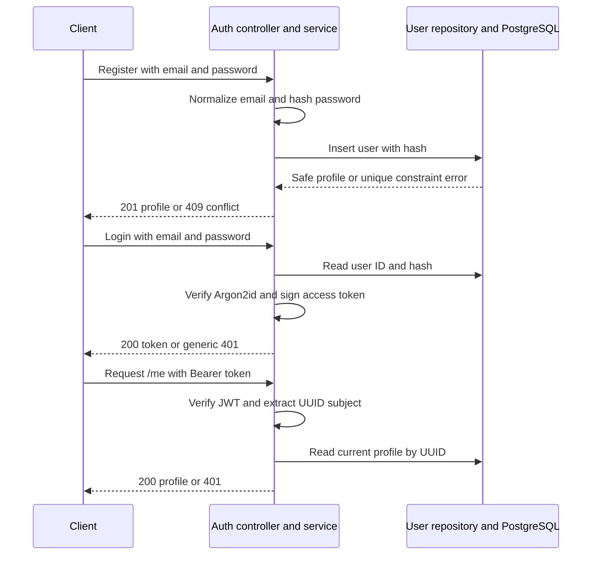
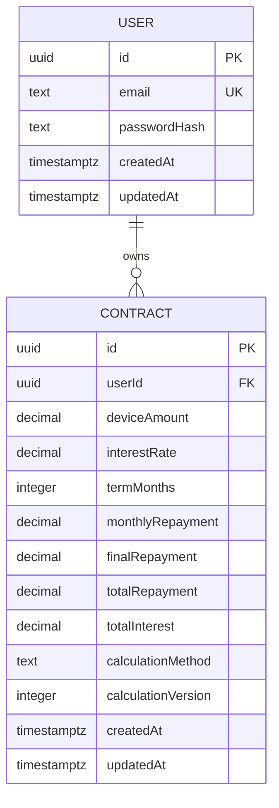

# Contract Repayment API architecture

## Modules and persistence

The private npm workspace owns the lockfile and quality commands. `apps/api`
owns the NestJS API, database schema, migrations, and application tests.
`AppModule` composes configuration and the authentication, health, users, and contracts modules.
Health controllers own routing and status codes. Feature repositories own
persistence operations and receive the shared Prisma service through Nest
dependency injection. Each repository exposes the operations demonstrated by
its feature. Callers use TypeScript records and fixed-scale decimal strings
without depending on Prisma input types or `Decimal` objects.

User creation accepts a password hash. Profile lookups and create results
select only profile fields. The internal login lookup selects only a user ID
and password hash. Both credential routes trim and lowercase the email.
The migration canonicalizes existing addresses and the unique index handles
concurrent registrations. A conflicting legacy pair stops the migration for
manual resolution. Review existing internationalized addresses before
migration because PostgreSQL case folding follows the database locale.

## Authentication flow

The global Passport guard protects routes by default. Use `@Public()` for
intentional anonymous routes. Liveness, readiness, registration and login
are public. Protected handlers can use `@CurrentUser()` for the typed UUID
principal. Passport verifies the HS256 signature, expiration, issuer and
audience. The strategy also requires an expiration claim and UUID subject.
Tokens contain subject, issuer, audience, issuance and expiration only.
The profile route checks account existence. Future protected endpoints
must decide whether their operation requires a current-account check.

Argon2id uses 19 MiB, two passes, one lane and a random salt from the library.
Login verifies a precomputed dummy hash for unknown accounts, so both failed
credential paths perform password verification. Database and runtime
variation can still affect timing. HTTP 409 on duplicate registration
allows account enumeration. Both credential failure paths return the
same generic HTTP 401 response.

Helmet, a 16 KiB body limit and the global DTO pipe apply to HTTP requests.
The pipe rejects unexpected properties and avoids implicit conversion.
Authentication errors are sanitized before reaching logs or clients.
The browser origin allowlist is explicit and cookie credentials are disabled.
Rate limiting counts registration and login separately by socket IP in
memory per instance. Forwarded headers are ignored. Users behind a shared
proxy can share a quota. Coordinate rate limiting at trusted ingress before
scaling horizontally. Deploy with TLS and runtime-managed random keys.
Stateless access tokens have no per-token revocation and expire after their
configured lifetime. Rotating the key invalidates all earlier tokens.

## Data model

PostgreSQL generates UUID primary keys and provides timestamp defaults. Prisma
maintains `updatedAt` for ORM updates. Every contract has one existing owner.
The foreign key restricts deletion and ID changes for users with contracts,
preserving contract ownership. An index on `Contract(userId, createdAt DESC,
id DESC)` supports owner lookup and deterministic listing.

Monetary values use `NUMERIC(14,2)`, with 12 integer digits and two
fractional digits. Rates use `NUMERIC(9,6)` in percentage points. A 6.5%
rate is stored as `6.500000`. The migration requires a positive term and
finite nonnegative numeric values. Calculated fields are stored as snapshots
provided by callers. The repository performs no calculation. PostgreSQL
rounds values that exceed the declared scale during insertion, so the future
calculation service should supply values at the chosen business precision.
The calculation feature applies fixed terms and rounding before returning
quotes. The schema remains independent of the calculation policy.

## Repayment calculation

`RepaymentModule` owns the authenticated `POST /api/v1/contracts/calculate`
route. The controller validates the request through the global DTO pipe and
maps unsupported amounts to HTTP 400. The service fixes the annual rate to
6.500000 percentage points and requests 12, 24 and 36 months in order.
The existing JWT guard authenticates the request. The module has no
persistence dependency, and neither the service nor the calculator reads
or writes the database.

**Implementation assumptions.** The proposed model uses a nominal 6.5%
annual rate, monthly reducing-balance amortisation, equal end-of-month
instalments with a final rounding adjustment, and no deposit, additional fees,
insurance or balloon payment. The model uses `M = P × r × (1 + r)^n / ((1 + r)^n − 1)`
with `r = annual percentage points / 1200`. The internal zero-rate case
uses `P / n`. The API exposes a fixed rate and fixed terms.

The strategy uses an isolated 60-significant-digit decimal.js context with
half-up rounding. The quote rounds the exact payment multiplied by the term
to determine the total. It rounds the regular payment to cents and derives
the final payment as the remainder. For tiny balances where half-up regular
payments would overpay the total before the final month, it uses the lower
cent for the regular payment. The final instalment stays nonnegative and
the payments always sum to the quoted total. Interest equals total minus
principal. Money is serialized with two decimal places. The principal and
all quoted monetary values fit `NUMERIC(14,2)`.

For R15,000 over 12 months, eleven payments of R1,294.45 plus a final
R1,294.41 produce R15,533.36, including R533.36 interest. At the low end,
a R0.18 quote over 36 months produces a R0.20 total collected in the
final payment. This is a quote-level rounding convention. A future payment
ledger may need a separate policy for rounding accrued interest each month
and settling the resulting balance.

The Nest provider token `REPAYMENT_CALCULATOR` binds a small strategy
interface to the pure `AmortisedRepaymentCalculator`. This keeps
the formula directly testable and lets a future policy replace the algorithm
without moving interest or term selection into the controller. The interface
and provider binding add one layer of indirection. To change the strategy,
implement `RepaymentCalculator`, provide its method identifier, update the
binding in `repayment.module.ts`, and validate the new strategy with independent
reference values and the storage bounds. Review the API compatibility and
update the examples if the policy changes an existing quote.

## Contract lifecycle and ownership

`ContractsModule` imports the repayment service and adds a controller,
service and repository. The controller reads the UUID principal from
`@CurrentUser()`. The service passes that ID separately from validated
financial inputs. Every list, count, detail, lock, update and delete query
includes the owner predicate. Foreign and missing rows return the same
HTTP 404. The repository maps explicit response fields and formats money
to two decimals and rates to six decimals in percentage points.

Creation and PATCH select an option from the existing comparison engine.
This keeps the same technical purchase ceiling, R906,319,135,069.39, for all
three terms. The ceiling is derived from the 36-month `NUMERIC(14,2)`
total and represents storage capacity. The implementation adds no
business price limit. Snapshots retain the method identifier and version
of the calculation strategy. Version 1 identifies the Phase 4 policy.
Increment the version when rounding or calculation behaviour changes.
Existing snapshots keep their stored values until an explicit edit.

PATCH locks the target row with an owner-scoped, parameterized
`SELECT ... FOR UPDATE` inside a PostgreSQL read-committed transaction.
The service merges supplied inputs with the locked row and computes one
complete snapshot. Prisma writes it in the same transaction. Concurrent
edits to different fields merge, while edits to the same field take effect
in lock order. Calculation or database failures roll back the transaction.
Creation time stays fixed and Prisma updates the modification timestamp.

List and count share a repeatable-read snapshot. Offset pagination provides
exact page counts and stable tie ordering. Rows can shift between separate
page requests when contracts are inserted or deleted, and deep offsets
can be expensive. Deletion uses a single owner-filtered hard delete. This
keeps the assessment simple and removes the quote permanently. Production
retention or audit requirements may call for soft deletion or a separate
audit trail. The records represent editable quotes and do not serve as
executed loan agreements or a payment ledger.

### Migration compatibility

The Phase 5 migration adds nullable metadata and final payment columns
without backfilling unknown history. PostgreSQL `NOT VALID` checks enforce
supported terms, positive principal, complete metadata and both repayment
identities on inserts and updates, while preserving historical rows.
Earlier finite, nonnegative checks remain enforced. Legacy fields can
remain null until a successful PATCH replaces the entire snapshot. An
incompatible legacy amount or term must be supplied in the patch.
The index change and constraint installation run transactionally and may
block writes during migration. Plan the index build for populated databases.

## Prisma, environment, and deployment

Prisma 7 generates TypeScript into an ignored directory beneath `src`. Its
CommonJS output is emitted with the rest of the Nest application. The
PostgreSQL adapter uses `pg` and one shared pool per Nest application.
`prisma.config.ts` loads CLI configuration from the repository-root
`.env` and supports client generation without a live database. Nest validates
the configured URL before it starts accepting requests. The URL and its
credentials are omitted from validation and readiness responses.

The API opens connections on demand, so it can report liveness during an
outage. Nest shutdown hooks close the Prisma pool. Pool connection acquisition
has a two-second timeout and driver queries have a three-second client timeout.
`GET /api/v1/health` performs no database query. The readiness route
`GET /api/v1/health/ready` executes one `SELECT 1` per probe and
returns HTTP 503 if it fails. Readiness verifies connectivity. The migration
job verifies migration application before the API starts in Compose.

Base Compose uses PostgreSQL 17, a named volume, and an internal database
network address. The optional local override publishes a loopback port for
host development. Compose shares one initialization role between the
migration job and the API for local use. A production deployment should give
its migration job and API separate credentials with appropriate privileges.
The runtime image installs production dependencies and omits optional
dependencies, including the Prisma CLI that npm can otherwise install as an
optional client peer.

## HTTP observability

`http/` contains the global exception filter, shared response formatter,
request middleware, validation adapter and Pino options. `APP_FILTER`
registers the filter through Nest dependency injection. The Express
parser error handler runs ahead of Nest controllers and sends the same
envelope. These boundaries preserve status codes and existing headers.
The former authentication filter and controller-level repayment mappings
are handled centrally. The exception filter maps existing domain errors,
standard HTTP exceptions and recognized Prisma connectivity failures.
Other exceptions become generic HTTP 500. Readiness keeps its dedicated
public body for compatibility.

The earliest HTTP middleware generates a UUID, writes it to
`X-Request-ID` and stores it in response locals. The response formatter
uses those locals for errors. A single completion listener closes over
the same ID and duration clock. No request-scoped provider or shared
mutable current-request pointer is needed. Incoming IDs are ignored.
The CORS allowlist exposes the response header to approved browsers.

NestJS Pino bridges application and buffered startup messages to JSON.
Automatic pino-http request logging is disabled. Our completion listener
emits one event with method, matched route template, status, duration,
request ID and optional safe error code. Parser failures, unmatched
routes and preflight requests may use the `unmatched` route label.
Aborted responses emit one abort event with log status 499. Exceptions
are represented by the same completion record, which avoids duplicate
logs. Startup failure output is generic and uses stderr.

HTTP event construction excludes request and response objects, raw paths,
queries and credential material. Defensive Pino redaction covers common
sensitive fields and replaces serialized errors with a fixed message.
Validation responses omit raw values and field names. This is request
correlation within the service. Cross-service tracing, metrics and a
log aggregation or retention pipeline are outside this phase.

## OpenAPI documentation

`openapi/` configures Swagger UI at `/api/docs` and the JSON document at
`/api/docs-json`. Nest scans route and DTO metadata from the existing
controllers. Shared response components describe fixed-scale money,
legacy snapshot nulls, pagination, health bodies and the standard error
envelope. The error examples use the same code and message definitions
as the global exception filter. A shared operation decorator attaches the
`X-Request-ID` response header and declares bearer security or explicit
public access. That declaration describes the route. The existing JWT
guard and owner-filtered repository enforce access at runtime.

`SWAGGER_ENABLED` accepts only `true` and `false`. Development enables the
routes by default, and production and tests require opt-in. The example
environment explicitly enables the local assessment demonstration. UI scripts,
styles and the specification are served from the same origin with Helmet’s
existing policy. The UI uses the local specification URL and keeps bearer
credentials in memory. The JSON spec and UI are publicly accessible when
enabled, so an internal production deployment should restrict them at
the ingress and use TLS. See the README for the register, authorize,
calculate and contract CRUD demonstration.

## Monitoring and alerting

The Prometheus registry is per API instance. The existing request completion
callback records one counter increment and one histogram observation, including
errors and client disconnects (synthetic status 499). The histogram measures
server-side elapsed seconds and uses buckets from 5 ms to 5 s, including the
500 ms alert threshold.

| Metric                              | What it measures                                                        |
| ----------------------------------- | ----------------------------------------------------------------------- |
| `http_requests_total`               | Completed or aborted requests by method, route template and status code |
| `http_request_duration_seconds`     | Duration histogram with the same bounded labels                         |
| Default process and Node.js metrics | CPU, memory, event-loop lag, garbage collection and runtime version     |

Requests that never reach a handler use `unmatched`. Swagger routes use
`documentation`, and methods outside the standard set use `OTHER`. Paths
come from registered Express templates. IDs, query strings, raw URLs and
request correlation IDs are excluded from metric labels. Scrapes are handled
on a separate listener and never enter the API counters or HTTP logging.

Metrics are opt-in and bind to loopback by default. The monitoring overlay
joins Prometheus and the API on a dedicated bridge, leaves port 9464
unpublished, and binds the Prometheus UI to host loopback. Other containers
that can reach the API on its application network can also reach the listener
when it binds all interfaces, so keep both networks restricted to trusted
services. For production, keep metrics off public ingress and use network
policy or a private authenticated TLS proxy when crossing trust boundaries.

Prometheus scrapes and evaluates every 15 seconds. The initial rules are
per target.

| Alert              | Trigger and first action                                                                                                                                            |
| ------------------ | ------------------------------------------------------------------------------------------------------------------------------------------------------------------- |
| Target unavailable | One minute of failed scrapes. Check service health, listener configuration and network connectivity. This detects scrape failures rather than PostgreSQL readiness. |
| High 5xx rate      | Over 5% for five minutes using a rolling five-minute window. Correlate server errors by route with structured logs and database readiness.                          |
| High p95 latency   | Over 500 ms for five minutes using a rolling five-minute histogram. Inspect slow routes, runtime metrics and database behavior.                                     |

The HTTP rules cover matched versioned API routes and require at least 60
estimated requests in the five-minute window. That filters low-volume
noise while allowing the target-down rule to fire without traffic. Deep
database outages may contribute readiness errors. Histogram quantiles and
`increase()` are estimates. These thresholds are initial operating values
and should be revisited against production traffic and service objectives.

For production notifications, configure Prometheus `alerting.alertmanagers`
with a private Alertmanager deployment. Route by severity and environment,
configure authenticated receivers, and verify delivery with a synthetic
alert before relying on paging. The Compose overlay evaluates alerts but
has no notification receiver.

### Performance and database review

The benchmark runs sequential endpoint scenarios against an isolated Windows
Docker Desktop stack from a Windows Node.js client. It uses one registered
user and one login, then reuses the bearer token without changing rate
limits. It times complete response reads under fixed concurrency. This
includes local networking and database work but excludes registration,
login, warm-up and fixture insertion.

Listing scopes both queries by owner inside a repeatable-read transaction.
The existing composite index covers owner filtering and the descending
creation-time and ID ordering. Offset pagination still has to visit skipped
rows, and the exact count scans qualifying rows or index entries on each
page. The API caps page size at 100 and defaults to 20. Prisma reuses one
node-postgres pool per API instance, with the driver default maximum of 10
connections plus configured 2 s connection and 3 s query timeouts. Review
total pool capacity against PostgreSQL's connection budget before scaling
replicas. The benchmark does not measure pool saturation or high concurrency.

One baseline run on Windows Docker Desktop used Node.js 24.21.0, PostgreSQL
17.12, Prometheus 3.11.0, eight workers and 2,000 measured requests per
endpoint after 100 warm-up requests. The fixture contained 22,000 contracts,
2,000 of which belonged to the requesting user.

| Endpoint                                         | Requests/s |      p50 |      p95 |      p99 | Errors |
| ------------------------------------------------ | ---------: | -------: | -------: | -------: | -----: |
| Repayment calculation                            |   1,010.83 |  7.35 ms | 13.88 ms | 18.67 ms |     0% |
| Authenticated contract listing, first page of 20 |     534.08 | 14.42 ms | 21.18 ms | 26.58 ms |     0% |

PostgreSQL used an ordered composite index scan for the first page
(0.020 ms). At offset 1,980 it used a bitmap scan and sort (0.358 ms).
The separate exact count used a bitmap scan (0.201 ms). These are executor
times for one seeded dataset. The measured first-page performance did not
justify an index, pool or pagination change. The dataset and closed-loop
run do not establish production capacity or deep-page latency under load.

## Verification and trade-offs

Unit tests exercise financial invariants, configuration and database error
classification. HTTP tests use the real Nest pipeline for validation,
authentication, sanitized errors and request correlation. They use a
loopback-only PostgreSQL endpoint for unavailable-connection scenarios.
Integration tests use real PostgreSQL for repository behavior, ownership,
relational constraints and rollback. The concurrent PATCH test holds the
target row and observes both database lock waiters before releasing it.
Database tests close Nest applications, which disconnect their Prisma pools.

Each integration run uses a uniquely named Compose project and an empty
PostgreSQL database on temporary storage, with no published port. The runner
applies the committed migrations and cleans up the test stack. Jest enables
Node VM module support for the Prisma query compiler. The combined coverage
command instruments all three projects together in that container and mounts
only the report output directory on the host. It reports the union of executed
lines and branches. The host unit and HTTP report provides a separate
like-for-like comparison. Both retain the existing scope, which excludes
generated code, test files and the process entry point. Bootstrap requires a
separate runtime smoke check.

The combined quality gate uses thresholds of 90% statements, 85% branches,
90% functions and 90% lines. It runs open-handle diagnostics without forcing
Jest to exit and shuffles test order with a seed Jest prints for replay.
The GitHub Actions workflow runs the root quality command and production audit.

The Phase 7 audit reported zero production findings with optional
dependencies included. The full audit still reported 19 moderate
development findings across the Nest CLI and Jest tooling chains. The
underlying advisories require `glob` 14.0.2 and `minimatch` 11.0.1 or
later. The compatible npm audit preview proposed
`babel-plugin-istanbul` 8.0.2 but left all 19 findings. npm's proposed
Nest CLI 12.0.15 upgrade and Jest 29.7.0 downgrade cross major-version
boundaries. Review those changes separately or wait for supported
dependency updates. The existing Effect 3.22.5 override remains in place.
