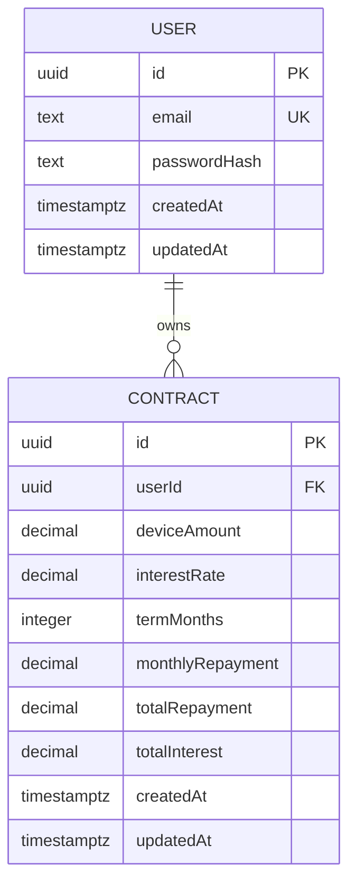

# Contract Repayment API architecture

## Modules and persistence

The private npm workspace owns the lockfile and quality commands. `apps/api`
owns the NestJS API, database schema, migrations, and application tests.
`AppModule` composes configuration and the health, users, and contracts modules.
Health controllers own routing and status codes. Feature repositories own
persistence operations and receive the shared Prisma service through Nest
dependency injection. Each repository exposes the operations demonstrated by
its feature. Callers use TypeScript records and fixed-scale decimal strings
without depending on Prisma input types or `Decimal` objects.

User creation accepts a password hash from its caller. User queries and create
results select only the profile fields at the database boundary. Credential
verification will need a dedicated internal operation when authentication is
introduced. The database currently enforces case-sensitive email uniqueness.
Email normalization depends on the future authentication policy.

## Data model

PostgreSQL generates UUID primary keys and provides timestamp defaults. Prisma
maintains `updatedAt` for ORM updates. Every contract has one existing owner.
The foreign key restricts deletion and ID changes for users with contracts,
preserving contract history. An index on `Contract.userId` supports owner
lookups.

Monetary values use `NUMERIC(14,2)`, with 12 integer digits and two
fractional digits. Rates use `NUMERIC(9,6)` in percentage points. A 6.5%
rate is stored as `6.500000`. The migration requires a positive term and
finite nonnegative numeric values. Calculated fields are stored as snapshots
provided by callers. The repository performs no calculation. PostgreSQL
rounds values that exceed the declared scale during insertion, so the future
calculation service should supply values at the chosen business precision.
These storage constraints establish no formula or supported term list.

## Prisma, environment, and deployment

Prisma 7 generates TypeScript into an ignored directory beneath `src`. Its
CommonJS output is emitted with the rest of the Nest application. The
PostgreSQL adapter uses `pg` and one shared pool per Nest application.
`prisma.config.ts` loads CLI configuration from the repository-root
`.env` and supports client generation without a live database. Nest validates
the configured URL before it starts accepting requests. The URL and its
credentials are omitted from validation and readiness responses.

The API opens connections on demand, so it can report liveness during an
outage. Nest shutdown hooks close the Prisma pool. Pool connection acquisition
has a two-second timeout and driver queries have a three-second client timeout.
`GET /api/v1/health` performs no database query. The readiness route
`GET /api/v1/health/ready` executes one `SELECT 1` per probe and
returns HTTP 503 if it fails. Readiness verifies connectivity. The migration
job verifies migration application before the API starts in Compose.

Base Compose uses PostgreSQL 17, a named volume, and an internal database
network address. The optional local override publishes a loopback port for
host development. Compose shares one initialization role between the
migration job and the API for local use. A production deployment should give
its migration job and API separate credentials with appropriate privileges.
The runtime image installs production dependencies and omits optional
dependencies, including the Prisma CLI that npm can otherwise install as an
optional client peer.

## Verification and trade-offs

Unit and HTTP end-to-end tests contribute to the Jest coverage report. The
report excludes generated code and the process entry point. Real PostgreSQL
integration tests run on a uniquely named Compose network with an unpublished
database and temporary storage. The suite applies the migration to an empty
database and checks repository behavior, relational constraints, decimal
round-tripping, and readiness. The ordinary end-to-end suite verifies the
unavailable response with a loopback-only fixture connection. Jest enables
Node VM module support so Prisma can dynamically load its query compiler
inside the test runner.

The full npm audit reported 19 moderate development findings. For the Nest
CLI chain through `glob` and `minimatch`, npm proposed Nest CLI 12.0.15. For
the Jest runner and coverage chain through `babel-plugin-istanbul`,
`test-exclude`, `glob`, and `minimatch`, npm proposed Jest 29.7.0. Both
proposed versions cross a major-version boundary and require compatibility
review. The Prisma CLI's Effect advisory was resolved with a targeted override
to `effect` 3.22.5. Remove the override when Prisma depends on a patched
release and the full audit confirms it. The production dependency audit
reported zero findings.
